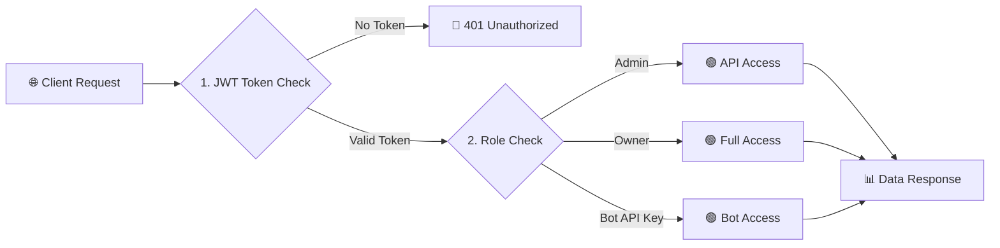
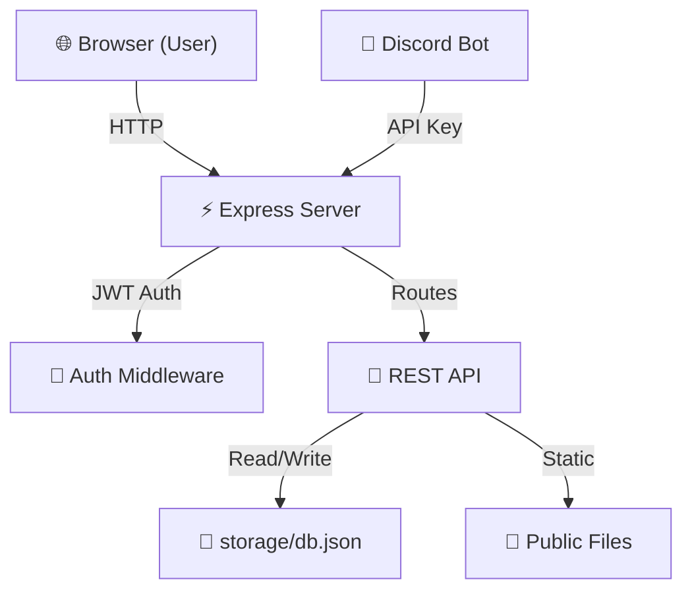

<div align="center">


</div>

<div align="center">

<a href="https://git.io/typing-svg">
  
</a>

<br/>


</div>

<br/>

<div align="center">

[]()
[](package.json)
[](package.json)
[](package.json)
[](LICENSE)

[](https://your-domain.com)

</div>


<br/>

## 🌌 &nbsp; PROJECT OVERVIEW

<div align="center">
  
  <br/>
  <sub><b>Figure 1:</b> League Hub Dashboard - Live standings, fixtures, and news</sub>
</div>

<br/>

**League Hub** is a complete, production-ready football league management system built for the **UEFA Champions League**. It provides:

- 📊 **Live League Standings** with automatic ELO/points calculation
- 📅 **Match Scheduling & Results** with real-time updates
- 📰 **News Management** with image support
- 🔐 **Admin Dashboard** with full CRUD operations
- 🤖 **Discord Bot Integration** for server commands
- 🎨 **Modern UI** with TailwindCSS & Glassmorphism

<table>
<tr>
<td width="55%">

### 💡 Core Objective
Provide a lightweight, self-contained football league management system that runs on a single Node.js server with JSON storage — no external database required.

### 🎯 Key Capabilities
- **League Standings**: Auto-calculated points, goal difference, and form
- **Match Management**: Schedule, update, and publish results
- **Team Management**: Add, edit, retire teams with logos
- **News System**: Publish articles with images and categories
- **Admin Panel**: Secure dashboard with role-based access
- **Discord Bot**: Slash commands for standings, matches, results

</td>
<td width="45%" align="center">

| Feature | Status | Tech |
|:---:|:---:|:---:|
| 🗄️ **Storage** | ✅ JSON | File System |
| 🔐 **Auth** | ✅ JWT | bcryptjs |
| 🤖 **Bot** | ✅ Discord.js | v14 |
| 🎨 **UI** | ✅ Tailwind | CSS |
| 📊 **Standings** | ✅ Auto | Algorithm |
| 📱 **Responsive** | ✅ Yes | CSS Grid |

</td>
</tr>
</table>


<br/>

## 🛡️ &nbsp; SECURITY ARCHITECTURE



<br/>

**Security Layers:**

1. **JWT Authentication** - 7-day expiration, bcrypt password hashing
2. **Role-Based Access** - Admin vs Owner permissions
3. **Bot API Key** - Separate authentication for Discord bot
4. **CORS Protection** - Restrict to allowed origins
5. **Input Sanitization** - XSS prevention via escaping


<br/>

## 🏗️ &nbsp; SYSTEM ARCHITECTURE



<br/>

<div align="center">

| Layer | Component | Technology |
|:---:|:---|:---:|
| `01` | **Frontend** | HTML + TailwindCSS + Vanilla JS |
| `02` | **Backend** | Node.js + Express.js |
| `03` | **Auth** | JWT + bcryptjs |
| `04` | **Storage** | JSON File System |
| `05` | **Bot** | Discord.js v14 |
| `06` | **Deployment** | Render / Railway / VPS |

</div>


<br/>

## 🎨 &nbsp; UI FEATURES

<!-- 🖼️ ADMIN PANEL SCREENSHOT -->
<div align="center">
  
  <br/>
  <sub><b>Figure 2:</b> League Hub Admin Panel - Manage teams, fixtures, results, and news</sub>
</div>

<br/>

<!-- 🖼️ DISCORD BOT SCREENSHOT -->
<div align="center">
  
  <br/>
  <sub><b>Figure 3:</b> League Hub Discord Bot - Manage league data directly through Discord</sub>
</div>

<br/>


<br/>

## 📡 &nbsp; API REFERENCE

<details open>
<summary>
  <b>&nbsp;🔐 &nbsp;<code>POST</code>&nbsp; /api/auth/login &nbsp;—&nbsp; Admin Login</b>
</summary>

<br/>

```javascript
// Request
POST /api/auth/login
{
  "username": "username",
  "password": "password"
}

// Response
{
  "token": "xxxxxxxxxxxx...",
  "admin": {
    "id": "admin-001",
    "username": "username",
    "role": "owner"
  }
}
```

</details>

<details>
<summary>
  <b>&nbsp;📊 &nbsp;<code>GET</code>&nbsp; /api/standings &nbsp;—&nbsp; Get League Table</b>
</summary>

<br/>

```javascript
// Response
[
  {
    "position": 1,
    "teamId": "abc123",
    "name": "Real Madrid",
    "played": 6,
    "wins": 5,
    "draws": 1,
    "losses": 0,
    "goalsFor": 15,
    "goalsAgainst": 4,
    "goalDifference": 11,
    "points": 16,
    "form": ["W", "W", "W", "D", "W"]
  }
]
```

</details>

<details>
<summary>
  <b>&nbsp;⚽ &nbsp;<code>POST</code>&nbsp; /api/teams &nbsp;—&nbsp; Add Team (Admin)</b>
</summary>

<br/>

```javascript
// Request (requires JWT)
POST /api/teams
{
  "name": "Real Madrid",
  "shortName": "RMA",
  "tag": "RM",
  "logoUrl": "https://example.com/logo.png",
  "description": "Spanish giants"
}
```

</details>


<br/>

## 🤖 &nbsp; DISCORD BOT COMMANDS

<div align="center">

| Command | Description | Example |
|:---|:---|:---|
| `/standings` | Show current league table | `/standings` |
| `/team add` | Add a new team | `/team add name:Real Madrid` |
| `/team remove` | Retire a team | `/team remove team_id:abc123` |
| `/team info` | Get team details | `/team info name:Real Madrid` |
| `/fixture add` | Schedule a match | `/fixture add home_team_id:abc123 away_team_id:def456 date:2026-09-15T20:00:00` |
| `/result add` | Post match result | `/result add match_id:abc123 home_score:3 away_score:1` |
| `/news post` | Publish news | `/news post title:El Clásico! body:Full article...` |
| `/help` | Show all commands | `/help` |

</div>

<br/>


<br/>

## 🚀 &nbsp; QUICK START

### 📦 Installation

```bash
# 1. Clone the repository
git clone https://github.com/Azu-rial/League-Hub.git
cd League-Hub

# 2. Install dependencies
npm install

# 3. Install bot dependencies
cd bot
npm install
cd ..

# 4. Configure environment
cp .env.example .env
# Edit .env with your values

# 5. Start the server
node server/index.js

# 6. Start the bot (optional - in new terminal)
cd bot
node index.js
```

### 🐳 Docker Deployment

```bash
# Build and run with Docker
docker build -t league-hub .
docker run -p 4000:4000 --env-file .env league-hub
```


<br/>

## 🔑 &nbsp; ENVIRONMENT VARIABLES

<div align="center">

| Variable | Description | Example | Required |
|:---|:---|:---|:---:|
| `PORT` | Server port | `4000` | ✅ |
| `JWT_SECRET` | JWT signing key | `your-secret-here` | ✅ |
| `BOT_API_KEY` | Bot authentication key | `xxxxxxx...` | ✅ |
| `CORS_ORIGIN` | Allowed frontend origin | `http://localhost:4000` | ✅ |
| `BOOTSTRAP_OWNER_USERNAME` | Admin username | `username` | ✅ |
| `BOOTSTRAP_OWNER_PASSWORD` | Admin password | `password` | ✅ |
| `NODE_ENV` | Environment | `development` / `production` | ❌ |

</div>

<br/>


<br/>

## 📁 &nbsp; PROJECT STRUCTURE

```
league-hub/
├── .env.example          # Environment variables template
├── .gitignore            # Git ignore file
├── package.json          # Dependencies
├── README.md             # Documentation
├── server/               # Backend API
│   ├── index.js          # Server entry point
│   ├── lib/              # Libraries
│   │   ├── auth.js       # JWT authentication
│   │   ├── db.js         # Database functions
│   │   └── standings.js  # Standings calculator
│   └── routes/
│       └── api.js        # API routes
├── bot/                  # Discord Bot
│   ├── index.js          # Bot entry point
│   └── deploy-commands.js # Slash command registration
├── public/               # Frontend
│   ├── index.html        # Main page
│   ├── app.js            # Frontend JavaScript
│   ├── style.css         # Styling
│   └── logo.png          # Logo
└── storage/              # Data storage
    └── db.json           # Database (teams, matches, news)
```


<br/>

## 🛠️ &nbsp; TECH STACK

<div align="center">


</div>

<br/>

| Category | Technology |
|:---|:---|
| **Backend** | Node.js + Express.js |
| **Authentication** | JWT + bcryptjs |
| **Storage** | JSON File System |
| **Frontend** | HTML + TailwindCSS + Vanilla JS |
| **Bot** | Discord.js v14 |
| **Deployment** | Render / Railway / Docker |


<br/>

## 🤝 &nbsp; CONTRIBUTING

1. Fork the repository
2. Create your feature branch (`git checkout -b feature/AmazingFeature`)
3. Commit your changes (`git commit -m 'Add some AmazingFeature'`)
4. Push to the branch (`git push origin feature/AmazingFeature`)
5. Open a Pull Request


<br/>

## 📄 &nbsp; LICENSE

This project is licensed under the MIT License - see the [LICENSE](LICENSE) file for details.


<br/>

<div align="center">


<br/>

**Built with ❤️ by [Azu-rial](https://github.com/Azu-rial)**

</div>
